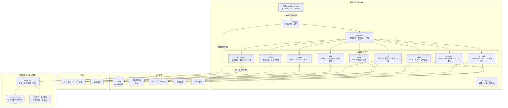
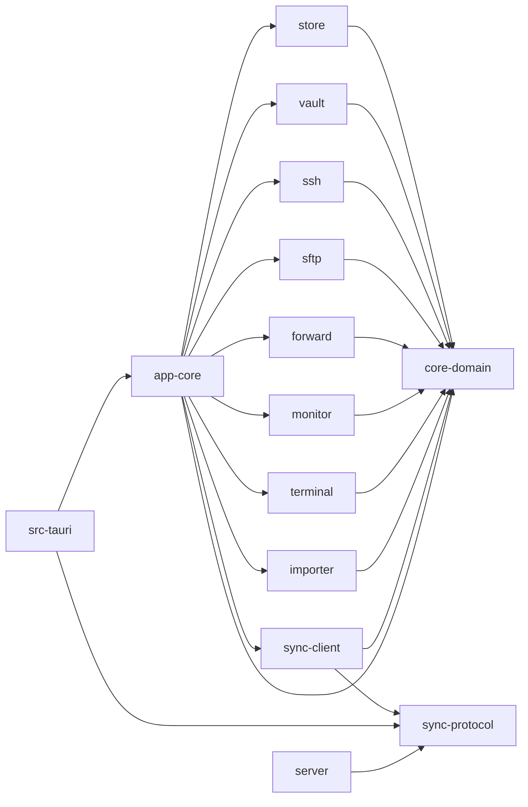
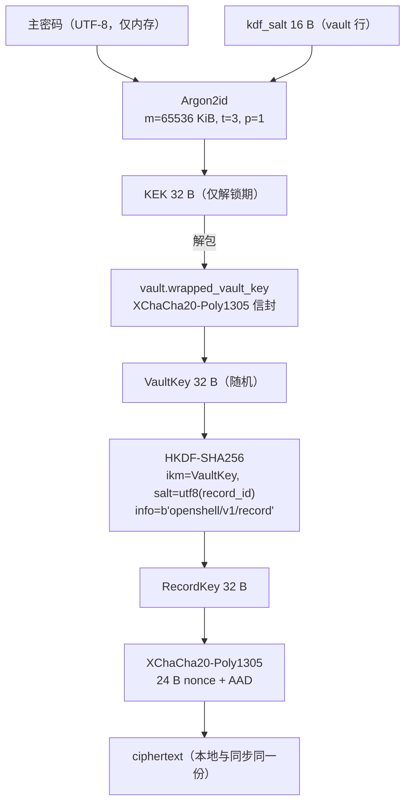
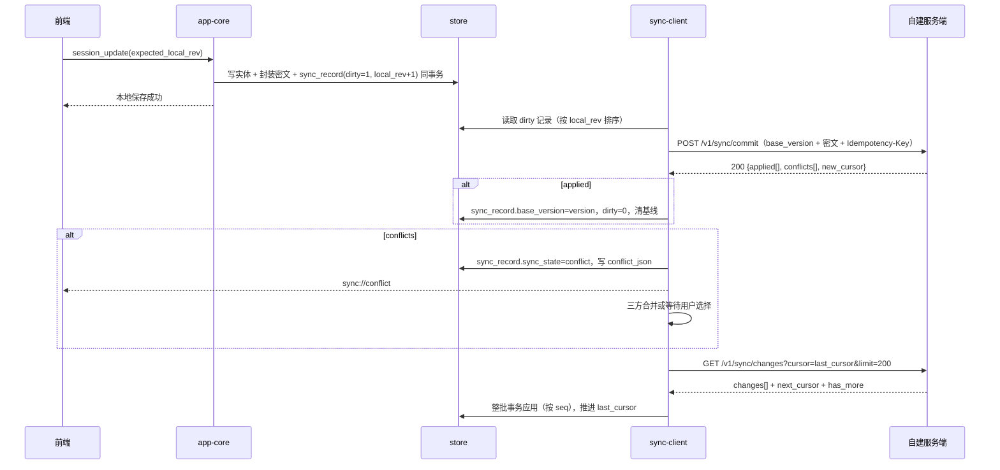

# OpenShell 架构设计

| 项 | 值 |
|---|---|
| 版本 | v1.0（M1） |
| 日期 | 2026-10-21 |
| 状态 | 待实现；已与 `spec/` M1 冻结版对齐（差异见 §20） |
| 目标文档 | `docs/openshell_design_prompt.md`（第 5/6/7 节） |
| 上游输入 | `spec/product.md`（SPEC-PRD-001）、`spec/data-model.md`（SPEC-DM-001）、`spec/sync-api.md`（SPEC-API-001）、`spec/ux.md`（SPEC-UX-001） |
| 相关 ADR | ADR-001 … ADR-008（`docs/adr/`） |
| 洁净室声明 | 本文只描述本项目自身设计；不含任何竞品代码、类名、字符串、图标、配色或品牌信息 |

---

## 1. 范围与架构目标

OpenShell 是一款轻量、跨平台的 SSH / 终端工作台，包含桌面客户端、可自建同步服务端与更新分发。架构服务于以下可验证目标：

| 目标 | 指标 | 架构手段 |
|---|---|---|
| 体积 | 安装包 ≤ 25 MB | Tauri 2 + 系统 WebView，无捆绑运行时（ADR-001） |
| 启动 | 冷启动 ≤ 1.5 s（p50） | 单一二进制；DB 延迟打开；首屏只查会话树（索引查询） |
| 内存 | 空闲 ≤ 150 MB | 单 WebView；WebGL 上下文按可见标签分配；终端缓冲上限可配 |
| 响应 | 100+ 会话滚动 60 fps | 虚拟列表；IPC 事件批处理；前端不做全量重渲染 |
| 可靠 | 终端不丢字节、不串标签 | 每标签独立有序管道 + 信用窗口背压（§7） |
| 安全 | 落盘无明文凭据 | Argon2id + XChaCha20-Poly1305 密钥分层（§9、ADR-005） |
| 可同步 | 端到端加密、冲突不丢数据 | 逐记录 `local_rev` + 乐观锁 + 版本向量（客户端扩展）+ 墓碑（§10、ADR-006） |

**非目标（首版）**：RDP/VNC、X11 转发、内置服务器、插件运行时、浏览器会话、P2P 组网。协议解析器、终端序列解析等一律不自行发明，使用成熟库。

---

## 2. 系统总览

### 2.1 分层

```
┌──────────────────────────────────────────────────────────────────────┐
│ 表现层   apps/desktop/src        React + TypeScript + xterm.js        │
├──────────────────────────────────────────────────────────────────────┤
│ 契约层   apps/desktop/src-tauri  Tauri 命令层（薄）：参数校验/类型映射/  │
│                                  事件转发/取消注册；不含业务规则         │
├──────────────────────────────────────────────────────────────────────┤
│ 编排层   crates/app-core         用例服务、事件总线、操作注册表、装配根   │
├──────────────────────────────────────────────────────────────────────┤
│ 适配层   crates/{store,vault,ssh,sftp,forward,monitor,terminal,          │
│                   sync-client,importer}   各自实现 core-domain 的端口   │
├──────────────────────────────────────────────────────────────────────┤
│ 领域层   crates/core-domain      实体、值对象、错误、端口 trait、事件     │
└──────────────────────────────────────────────────────────────────────┘
```

依赖方向**只能向下**：契约层 → 编排层 → 适配层 → 领域层。适配层之间不互相依赖，跨能力协作由 `app-core` 注入 trait 完成（§4.3）。

### 2.2 总览图



### 2.3 信任边界

| 边界 | 一侧 | 另一侧 | 规则 |
|---|---|---|---|
| B1 WebView ↔ Rust | 前端 JS | Tauri 命令层 | 只暴露白名单命令；参数经 serde 强类型校验；前端无文件系统/网络直通能力（`capabilities` 最小化） |
| B2 进程 ↔ 磁盘 | 内存中的 VaultKey 明文 | `openshell.db`（含 `vault` 表密钥槽） | 磁盘上只有 AEAD 密文与包裹后的密钥；VaultKey 仅在解锁期驻留，锁定即 zeroize |
| B3 客户端 ↔ 同步服务端 | 客户端 | 自建服务器 | TLS 之上的 E2EE：服务端只见不透明 ID、版本、密文、墓碑；无明文记录类型/字段名 |
| B4 客户端 ↔ 目标主机 | 客户端 | SSH 主机 | 默认严格校验主机密钥；首次连接必须显式确认；告警不可静默忽略 |
| B5 更新通道 | 客户端 | 更新清单/安装包 | Ed25519 签名清单 + 每个产物 SHA-256 与签名双重校验；失败即中止 |

---

## 3. 进程与部署拓扑

- **桌面端**：单进程。Tauri 主进程内跑 Tokio 运行时；SQLite 写线程、PTY 读线程为阻塞线程池任务；无 sidecar（避免体积与升级复杂度）。
- **服务端**：单二进制 + Docker Compose；Caddy 负责 TLS 终止与反向代理。默认单用户（首次启动用一次性引导令牌创建唯一账号，随后注册接口关闭）；多用户通过配置开关启用（ADR-007）。
- **更新分发**：`GET /updates/{target}/{version|latest}` 返回签名清单，`/downloads/{artifact_id}` 返回产物（支持 Range）；可放对象存储，服务端只返回清单或 302 重定向。

---

## 4. Crate 边界

### 4.1 清单

| 目录 | 包名 | 职责 | 对外关键 trait / 类型 | 允许依赖 |
|---|---|---|---|---|
| `crates/core-domain` | `openshell-core-domain` | 实体、值对象（`SessionId`、`ConnectionId`、`TabId`、`TermSize`）、错误码、事件枚举、端口 trait | `SessionRepository`、`SecretResolver`、`ChannelOpener`、`ByteStream`、`RemoteForwardHandle`、`DomainError` | 仅 serde / uuid / time / thiserror / zeroize |
| `crates/store` | `openshell-store` | SQLite 打开、WAL 调参、迁移、仓储实现、单写者任务、FTS 查询 | `Store`、`StoreHandle::write()`、`Migrator`、各 `*Repository` | core-domain, rusqlite, tokio-rusqlite |
| `crates/vault` | `openshell-vault` | Argon2id、密钥分层、`vault` 表密钥槽（`wrapped_vault_key`/`key_check`）、记录级 AEAD、`.osvault` 导出、自动锁定、钥匙串适配 | `Vault`、`KeyHierarchy`、`SecretStore`（实现 `SecretResolver`）、`KeySlot`、`VaultPackage` | core-domain, argon2, chacha20poly1305, hkdf, zeroize, keyring |
| `crates/ssh` | `openshell-ssh` | russh 连接、认证（password/pubkey/keyboard-interactive/agent）、ProxyJump 链、主机密钥、keepalive、通道打开、自动重连 | `SshConnections`（实现 `ChannelOpener`）、`ConnectPolicy`、`HostKeyDecision`、`Backoff` | core-domain, russh, tokio, rustls |
| `crates/sftp` | `openshell-sftp` | 基于 `russh-sftp` 的文件操作、传输队列、并发与限速、断点续传（`resume` 记录）、目录监控、远程编辑回传 | `SftpService`、`TransferQueue`、`TransferJob`、`ResumeStore` | core-domain, russh-sftp, tokio, notify |
| `crates/forward` | `openshell-forward` | local / remote / dynamic(SOCKS5) 转发生命周期、健康检查、随会话自动启动 | `ForwardManager`、`ForwardSpec`、`ForwardRuntime` | core-domain, tokio |
| `crates/monitor` | `openshell-monitor` | 远端只读采集脚本、输出解析、自适应采样、平台降级 | `MonitorService`、`Collector`、`MonitorSample` | core-domain, tokio |
| `crates/terminal` | `openshell-terminal` | 本地 PTY（portable-pty）、串口（serialport）、远端通道适配；统一 `TerminalTransport` | `TerminalService`、`PtyTransport`、`SerialTransport`、`RemoteTransport` | core-domain, portable-pty, serialport |
| `crates/sync-protocol` | `openshell-sync-protocol` | 客户端与服务端共享的线协议 DTO 与错误码（仅 serde 模型，无 IO） | `CommitRequest`、`CommitResponse`、`ChangePage`、`Conflict` | serde, time |
| `crates/sync-client` | `openshell-sync-client` | 变更日志、出站队列、幂等推送、增量拉取、三方合并、墓碑、快照 | `SyncClient`、`Outbox`、`Merger`、`RecordEnvelope` | core-domain, sync-protocol, reqwest, tokio |
| `crates/importer` | `openshell-importer` | 按**文件格式规格**解析 OpenSSH config / CSV / 本产品导出包；预览与冲突处理 | `Importer`（`detect/preview/apply`）、`ImportPreview` | core-domain, serde, csv |
| `crates/app-core` | `openshell-app-core` | 装配根、用例服务、事件总线、操作注册/取消、策略（重试、限额） | `AppServices`、`AppEvent`、`OpRegistry` | 全部适配层 + core-domain |
| `apps/desktop/src-tauri` | `openshell-desktop` | Tauri builder、命令注册、事件桥、capabilities、单实例、托盘（可选） | 无业务 trait；只做 DTO 转换 | app-core, sync-protocol, tauri |
| `server/` | `openshell-server` | axum 路由、认证、设备、同步、更新清单、运维指标 | `AppState`、`routes()` | sync-protocol, axum, sqlx |
| `xtask/` | `openshell-xtask` | 构建辅助：依赖方向检查、许可证汇总、性能脚本编排 | CLI 子命令 | 仅开发工具链 |

`sync-protocol` 不依赖 `core-domain`：服务端不应被迫携带桌面领域模型；客户端在边界处做 DTO ↔ 实体映射。

### 4.2 依赖图与防环



**强制规则（CI 校验）**

1. `core-domain` 不得依赖任何 workspace 内其它 crate。
2. 适配层 crate 不得依赖 `app-core` 或 `src-tauri`。
3. 除 `app-core` 外，适配层之间不得互相 `use`；跨能力调用一律通过 `core-domain` 的 trait，由装配根注入。
4. `server` 不得依赖任何桌面 crate（`proto` 除外）。
5. CI 用 `cargo metadata` 生成邻接表，与 `xtask check-deps` 中的白名单比对；越界即失败。

### 4.3 核心端口 trait（可实现的契约）

```rust
// core-domain/src/ports.rs（节选；命名即实现契约）
#[async_trait::async_trait]
pub trait SecretResolver: Send + Sync {
    async fn resolve(&self, r: &CredentialRef, policy: PromptPolicy) -> Result<Secret, DomainError>;
}

pub enum Secret {
    Password(Zeroizing<String>),
    PrivateKey { pem: Zeroizing<Vec<u8>>, passphrase: Option<Zeroizing<String>> },
    Agent { socket: Option<PathBuf> },
    KeyboardInteractive,
}

pub trait ByteStream: AsyncRead + AsyncWrite + Send + Unpin {
    fn resize(&mut self, size: TermSize) -> Result<(), DomainError>;
    fn close(self: Box<Self>) -> Result<(), DomainError>;
}

#[async_trait::async_trait]
pub trait ChannelOpener: Send + Sync {
    async fn open_shell(&self, c: &ConnectionId, size: TermSize) -> Result<Box<dyn ByteStream>, DomainError>;
    async fn open_exec(&self, c: &ConnectionId, cmd: &str) -> Result<ExecOutput, DomainError>;
    async fn open_direct_tcpip(&self, c: &ConnectionId, host: &str, port: u16) -> Result<Box<dyn ByteStream>, DomainError>;
    async fn open_sftp(&self, c: &ConnectionId) -> Result<Box<dyn ByteStream>, DomainError>;
    async fn bind_remote(&self, c: &ConnectionId, host: &str, port: u16) -> Result<Box<dyn RemoteForwardHandle>, DomainError>;
}

#[async_trait::async_trait]
pub trait RemoteForwardHandle: Send {
    async fn accept(&mut self) -> Result<Box<dyn ByteStream>, DomainError>;
    fn bound_addr(&self) -> SocketAddr;
    async fn close(&mut self) -> Result<(), DomainError>;
}
```

- `sftp` 只拿到 `Box<dyn ByteStream>`，自行在其上构建 `russh-sftp::SftpSession`，因此不依赖 `ssh` crate。
- `terminal` 的远端模式只消费 `ByteStream`，本地模式创建 PTY/串口；三者对上层呈现同一 `TerminalTransport`。
- `ssh` 通过注入的 `SecretResolver` 取凭据，自身不读数据库、不解密保险库。

---

## 5. 领域模型（与 spec 的对应关系）

> 字段名、类型与约束以 `spec/data-model.md` 为准（SPEC-DM-001，已冻结）。本节只列实现侧需要理解的映射，不重新定义规格。

| 实体 | 表名 | 关键字段（与 spec 同名） | 说明 |
|---|---|---|---|
| `Vault` | `vault` | `id, name, schema_version, crypto_suite, kdf_alg, kdf_mem_kib, kdf_time, kdf_parallelism, kdf_salt, wrapped_vault_key, key_check, keychain_ref, server_url, account_id` | 密钥槽与同步配置；单用户默认 1 个 |
| `Group` | `session_group` | `id, parent_id, name, kind(session/snippet), sort_order, color, icon_key, expanded, version, origin_device_id, dirty` | 会话与片段共用分组树；深度 ≤ 8 |
| `Session` | `session` | `id, group_id, name, protocol, host, port, username, auth_method, credential_id, ssh_key_id, host_key_policy, proxy_jump_json, terminal_profile_id, encoding, startup_command, working_dir, keepalive_sec, keepalive_max_miss, auto_reconnect, reconnect_max, compression, agent_forwarding, tags_json, favorite, protocol_options_json, last_used_at, sort_order, version, origin_device_id, dirty, deleted_at` | `protocol ∈ ssh/sftp/telnet/serial/local_shell` |
| `Credential` | `credential` | `id, name, kind(password/keyboard_interactive/passphrase), username, secret_id, hint, save_policy, version` | 秘密在 `secret` 表，业务层不得直接读密文列 |
| `SshKey` | `ssh_key` | `id, name, algorithm, key_size, public_key, fingerprint_sha256, secret_id, passphrase_credential_id, has_passphrase, comment` | 私钥在 `secret` |
| `KnownHost` | `known_host` | `id, host, port, key_type, public_key, fingerprint_sha256, status(trusted/changed/revoked), previous_fingerprint, first_seen_at, changed_at, source` | `changed` 时连接必须阻断 |
| `Snippet` | `snippet` | `id, group_id, kind(snippet/macro), name, body, variables_json, macro_steps_json, send_mode(insert/execute), shortcut, sort_order` | 片段与宏共用表 |
| `PortForwardRule` | `port_forward` | `id, session_id, name, type(local/remote/dynamic), bind_host, bind_port, dest_host, dest_port, auto_start, auto_reconnect, reconnect_max, socks_auth, socks_password_ref, expose_warning_ack, sort_order` | 运行态独立，规则持久化 |
| `Setting` | `setting` | `id, scope, scope_id, key, value_json, value_type, syncable` | 作用域键值模型 |
| `Device` | `device` | `id, name, platform, arch, app_version, device_public_key, last_seen_at, last_sync_at, revoked_at` | 服务端权威，本地为快照 |
| `Secret` | `secret` | `id, record_type, ciphertext, nonce, aad, crypto_suite, key_version` | 唯一允许存密文的表 |
| `SyncMeta` | `sync_meta` | `vault_id, server_url, account_id, device_id, last_cursor, last_push_at, last_pull_at, last_error_code, conflict_count, next_retry_at, sync_state` | 单行 |
| `SyncRecord` | `sync_record` | `record_id, record_type, base_version, local_rev, server_checksum, sync_state(clean/dirty/conflict/deleted), conflict_json` | 与实体写入同事务 |

- **ID**：ULID 文本（26 字符，Crockford Base32），对服务端不透明。领域层类型 `SessionId`/`GroupId`/`DeviceId` 等均为 ULID newtype。
- **时间**：全部 Unix 毫秒（UTC）`INTEGER`；IPC 字段名与 spec 一致使用 `snake_case`（见 §6.1）。
- **同步元数据**：所有可同步实体带 `version`（服务端分配）、`origin_device_id`、`dirty`、`deleted_at`。`version=0` 表示尚未推送。
- **版本向量**：`VersionVector = BTreeMap<DeviceId, u64>` 由 `sync-client` 维护，存于实现扩展列/表（见 §20 Q13），不改变 spec 的实体字段语义。

---

## 6. Tauri IPC 契约

### 6.1 命名与序列化约定

| 项 | 约定 |
|---|---|
| 命令名 | `snake_case`，动词开头：`session_create`、`terminal_open` |
| 参数/返回字段 | `snake_case`，与 `spec/data-model.md` / `sync-api.md` 同名（Rust DTO 不做 rename_all） |
| 枚举线值 | `snake_case` 小写（`"local_shell"`、`"host_key_policy":"strict"`）；错误码为 `SCREAMING_SNAKE` |
| 事件名 | `域://事件`，如 `terminal://notice`、`connection://state` |
| ID | ULID 字符串（26 字符）；`request_id` 由前端生成（ULID 或 UUIDv4），用于取消与幂等 |
| 时间 | IPC 用 RFC 3339 UTC 字符串；DB 用 Unix 毫秒 `INTEGER` |
| 错误 | 所有命令返回 `Result<T, IpcError>`；禁止向 JS 抛原始错误字符串 |

```ts
// apps/desktop/src/lib/ipc/types.ts（提案，字段名与 spec 对齐）
export type EntityId = string;          // ULID
export type Protocol = "ssh" | "sftp" | "telnet" | "serial" | "local_shell";
export type ConnectionState =           // 对齐 SESS-009
  | "idle" | "resolving" | "tcp" | "handshake" | "auth"
  | "ready" | "degraded" | "closed";

export interface TermSize { cols: number; rows: number }
export interface IpcError {
  code: ErrorCode;            // 见 6.6
  message: string;            // 已脱敏、面向用户
  retryable: boolean;
  details?: Record<string, unknown>; // 仅非敏感结构化信息
  correlation_id: string;
}
```

### 6.2 命令清单（按域）

**应用与保险库**

| 命令 | 入参 | 返回 | 错误 |
|---|---|---|---|
| `app_info` | — | `{version, target, arch, data_dir}` | `INTERNAL` |
| `vault_status` | — | `VaultStatus {state, vault_id?, auto_lock_minutes, keychain_enabled, last_opened_at?}` | `VAULT_CORRUPT` |
| `vault_init` | `{master_password, remember_in_keychain, kdf_params?}` | `VaultStatus` | `VALIDATION`, `KEYCHAIN_UNAVAILABLE` |
| `vault_unlock` | `{master_password?, use_keychain}` | `VaultStatus` | `VAULT_DECRYPT_FAILED`, `VAULT_LOCKED`, `RATE_LIMITED` |
| `vault_lock` | `{}` | `VaultStatus` | — |
| `vault_change_password` | `{old_password, new_password, full_rekey?}` | `VaultStatus` | `VAULT_DECRYPT_FAILED`, `VALIDATION` |
| `vault_export` | `{path, include_secrets, passphrase}` | `{bytes, sha256}` | `CANCELLED`, `IO` |
| `vault_import` | `{path, passphrase}` | `ImportResult` | `VAULT_CORRUPT`, `CONFLICT` |

**会话与凭据**

| 命令 | 入参 | 返回 | 错误 |
|---|---|---|---|
| `session_list` | `{group_id?, query?, tags?, protocol?, favorite_only?, limit, cursor?}` | `Page<SessionSummary>` | `NOT_FOUND` |
| `session_get` | `{id}` | `SessionDetail` | `NOT_FOUND` |
| `session_create` | `{input: SessionInput}` | `SessionDetail` | `VALIDATION` |
| `session_update` | `{id, patch: SessionPatch, expected_local_rev?}` | `SessionDetail` | `CONFLICT` |
| `session_delete` | `{id}` | `{}` | `NOT_FOUND` |
| `session_restore` | `{id}` | `SessionDetail` | `NOT_FOUND` |
| `session_duplicate` | `{id}` | `SessionDetail` | `NOT_FOUND` |
| `session_move` | `{id, group_id, sort_order}` | `SessionSummary` | `CONFLICT` |
| `group_create/update/delete/move` | 同 session 模式（`parent_id, name, kind, sort_order`） | `Group` | `CONFLICT`, `VALIDATION` |
| `credential_list` | `{kind?}` | `CredentialSummary[]` | `VAULT_LOCKED` |
| `credential_create` | `{kind, name, username?, secret, hint?, save_policy?}` | `CredentialSummary` | `VAULT_LOCKED`, `VALIDATION` |
| `credential_delete` | `{id}` | `{}` | `NOT_FOUND`, `CONFLICT` |
| `ssh_key_generate` | `{algorithm: "ed25519"\|"rsa"\|"ecdsa", key_size?, comment?, passphrase?}` | `SshKeySummary & {public_key}` | `VALIDATION` |
| `ssh_key_import` | `{pem, passphrase?, name}` | `SshKeySummary` | `VALIDATION` |
| `ssh_key_delete` | `{id}` | `{}` | `CONFLICT` |
| `connection_test` | `{session_id}` | `{dns_ms, tcp_ms, handshake_ms, auth_ms, result}` | 各阶段对应错误 |
| `hostkey_decision` | `{request_id, decision: "trust"\|"trust_once"\|"reject", confirm_hostname?}` | `{}` | `TIMEOUT` |

**连接与终端**

| 命令 | 入参 | 返回 | 错误 |
|---|---|---|---|
| `connect_session` | `{request_id, session_id, overrides?: ConnectOverrides}` | `{connection_id, session_id}` | `AUTH_FAILED`, `HOSTKEY_MISMATCH`, `NETWORK`, `TIMEOUT`, `CANCELLED` |
| `connection_close` | `{connection_id}` | `{}` | `NOT_FOUND` |
| `connection_reconnect` | `{request_id, connection_id, mode: "resume"\|"fresh"}` | `{connection_id}` | 同上 |
| `connection_list` | `{}` | `ConnectionInfo[]` | — |
| `terminal_open` | `{tab_id, transport, size, on_data: Channel<ArrayBuffer>}` | `{tab_id}` | `UNSUPPORTED`, `CHANNEL_LIMIT` |
| `terminal_write` | 原始字节体（`Uint8Array`）+ `{tab_id}` | `{accepted: number}` | `NOT_FOUND` |
| `terminal_resize` | `{tab_id, cols, rows}` | `{}` | — |
| `terminal_ack` | `{tab_id, bytes}` | `{credit}` | — |
| `terminal_close` | `{tab_id}` | `{}` | — |
| `auth_answer` | `{request_id, answers: string[]}` | `{}` | `TIMEOUT` |
| `op_cancel` | `{request_id}` | `{}` | `NOT_FOUND` |

`transport` 判别联合（字段名对齐 `protocol_options_json`）：

```ts
type TerminalTransportInput =
  | { kind: "remote"; connection_id: string }
  | { kind: "local_shell"; shell?: "auto"|"powershell"|"cmd"|"bash"|"zsh"|"fish"|`wsl:${string}`;
      working_dir?: string; env?: Record<string,string> }
  | { kind: "serial"; device: string; baud: number; data_bits: 5|6|7|8;
      stop_bits: 1|2; parity: "none"|"even"|"odd";
      flow_control: "none"|"rtscts"|"xonxoff" };
```

**SFTP 与传输**

| 命令 | 入参 | 返回 | 错误 |
|---|---|---|---|
| `sftp_open` | `{connection_id}` | `{sftp_id, home, cwd}` | `SFTP_PROTOCOL` |
| `sftp_list` | `{sftp_id, path, show_hidden}` | `DirListing` | `SFTP_NO_SUCH_FILE`, `SFTP_PERMISSION` |
| `sftp_stat` | `{sftp_id, path}` | `FileStat` | 同上 |
| `sftp_mkdir/remove/rename/chmod/symlink` | `{sftp_id, ...}` | `{}` | `SFTP_PERMISSION` |
| `sftp_follow_cwd` | `{sftp_id, enabled}` | `{}` | — |
| `transfer_enqueue` | `{sftp_id, items: TransferItem[], options}` | `{transfer_ids: string[]}` | `SFTP_PROTOCOL`, `QUOTA_EXCEEDED` |
| `transfer_control` | `{transfer_id, action: "pause"\|"resume"\|"cancel"\|"retry"}` | `TransferSummary` | `CANCELLED` |
| `transfer_list` | `{active_only?}` | `TransferSummary[]` | — |
| `remote_edit_open` | `{sftp_id, path}` | `{transfer_id, local_path}` | `IO` |
| `file_compress` / `file_extract` | `{sftp_id, paths, format: "zip"\|"tar"\|"tar.gz", dest}` | `{transfer_id}` | `UNSUPPORTED` |

`TransferOptions`：`{conflict: "ask"|"overwrite"|"skip"|"rename", preserve_mtime, recursive, bandwidth_limit_bps?, max_concurrency}`；`max_concurrency` 取值 1–4，默认 2（FILE-006）。

**转发、监控、片段、多执行**

| 命令 | 入参 | 返回 | 错误 |
|---|---|---|---|
| `forward_list` | `{session_id?}` | `PortForwardRule[]` | — |
| `forward_create` / `forward_update` | 规则字段（见 `port_forward`） | `PortForwardRule` | `CONFLICT`, `VALIDATION` |
| `forward_delete` | `{id}` | `{}` | `NOT_FOUND` |
| `forward_start` / `forward_stop` | `{id}` | `ForwardState` | `FORWARD_BIND`, `FORWARD_REMOTE_DENIED` |
| `forward_start_all` / `forward_stop_all` | `{session_id?}` | `ForwardState[]` | 同上 |
| `monitor_start` | `{connection_id, interval_sec?, collectors?}` | `{monitor_id}` | `UNSUPPORTED` |
| `monitor_stop` | `{monitor_id}` | `{}` | — |
| `monitor_latest` | `{monitor_id}` | `MonitorSample` | `NOT_FOUND` |
| `snippet_list/create/update/delete` | `kind, group_id, name, body…` | `Snippet` | `CONFLICT` |
| `snippet_run` | `{snippet_id, tab_ids[], variables?, send_mode?}` | `{sent: number}` | `NOT_FOUND` |
| `macro_run` | `{snippet_id, tab_id, speed?}` | `{run_id}` | `VALIDATION` |
| `multi_exec_send` | `{tab_ids[], text, enter}` | `{sent: number}` | `NOT_FOUND` |

**同步、更新、设置、导入**

| 命令 | 入参 | 返回 | 错误 |
|---|---|---|---|
| `sync_configure` | `{server_url, device_name}` | `SyncStatus` | `VALIDATION` |
| `sync_register` | `{email, password, device_name}` | `SyncStatus` | `SERVER_AUTH`, `RATE_LIMITED` |
| `sync_login` | `{email, password}` | `SyncStatus` | `SERVER_AUTH`, `RATE_LIMITED` |
| `sync_logout` | `{}` | `SyncStatus` | — |
| `sync_status` | `{}` | `SyncStatus` | — |
| `sync_now` | `{direction: "push"\|"pull"\|"both"}` | `SyncRunResult` | `SERVER_UNREACHABLE`, `SYNC_CONFLICT` |
| `sync_conflict_list` | `{limit}` | `ConflictSummary[]` | — |
| `sync_conflict_resolve` | `{conflict_id, resolution: "local"\|"remote"\|"merge"\|"duplicate", merged_payload?}` | `{}` | `CONFLICT` |
| `sync_snapshot_create` | `{label?}` | `{snapshot_id, version}` | `QUOTA_EXCEEDED` |
| `sync_snapshot_restore` | `{snapshot_id}` | `{}` | `CONFLICT` |
| `update_check` | `{channel?: "stable"\|"beta"}` | `UpdateInfo?` | `SERVER_UNREACHABLE` |
| `update_download` | `{version}` | `{staged_path, sha256}` | `UPDATE_SIGNATURE` |
| `update_apply` | `{version, restart}` | `{}` | `UPDATE_DOWNLOAD` |
| `settings_get` | `{scope?, scope_id?}` | `Setting[]` | — |
| `settings_set` | `{scope, scope_id?, key, value}` | `Setting` | `VALIDATION` |
| `import_preview` | `{kind: "openssh_config"\|"csv"\|"json"\|"osvault", path, passphrase?}` | `ImportPreview` | `VALIDATION` |
| `import_apply` | `{job_id, mapping?, conflict_policy: "skip"\|"overwrite"\|"keep_both"\|"ask"}` | `ImportResult` | `CONFLICT` |
| `export_data` | `{path, format: "json"\|"csv"\|"osvault", scope, include_secrets, passphrase?}` | `{bytes, sha256}` | `VALIDATION` |
| `log_set_level` | `{level}` | `{}` | — |

### 6.3 事件目录

| 事件 | 载荷 | 频率 | 说明 |
|---|---|---|---|
| `terminal://notice` | `{tab_id, kind: "title"\|"cwd"\|"notify"\|"bell"\|"exit"\|"clipboard"\|"reset"\|"flow", value?, exit_code?}` | 低 | 批量数据走 Channel，不走事件；`flow` 携带 `paused` |
| `connection://state` | `{connection_id, state, attempt, next_retry_ms?, error?, host?}` | 低 | 指数退避 1/2/4/8/16/30 s（SESS-010） |
| `connection://hostkey` | `{request_id, host, port, key_algorithm, fingerprint_sha256, known_status}` | 连接期 | 等待 `hostkey_decision`，120 s 超时 |
| `auth://prompt` | `{request_id, name, instruction?, prompts: [{prompt, echo}]}` | 连接期 | keyboard-interactive |
| （应答） | 命令 `auth_answer {request_id, answers[]}` | — | 超时 120 s |
| `sftp://transfer` | `{transfer_id, state, bytes_done, bytes_total, rate_bps, error?}` | 500 ms 节流 | 队列进度 |
| `sftp://listing` | `{sftp_id, path, reason: "cwd"\|"invalidate"}` | 低 | 目录跟随/刷新 |
| `forward://state` | `{forward_id, state, bound_addr?, error?}` | 低 | — |
| `monitor://sample` | `{monitor_id, ts, cpu, mem, disk[], net[], load, procs}` | 1–30 s（默认 3 s） | 结构化，已降采样；页面隐藏时 10 s |
| `vault://state` | `{state: "locked"\|"unlocked", reason: "manual"\|"idle"\|"suspend"}` | 低 | 失焦/休眠自动锁 |
| `sync://state` | `{state, pending, cursor, last_error?}` | 低 | — |
| `sync://conflict` | `{conflict_id, record_type, created_at}` | 低 | 触发 UI 提示 |
| `update://state` | `{state: "checking"\|"available"\|"downloading"\|"ready"\|"installing"\|"error", version?, progress?, error?}` | 低 | — |
| `op://progress` | `{request_id, phase, done, total?}` | 节流 250 ms | 长操作 |
| `app://ready` | `{cold_start_ms, db_open_ms, ui_mounted_ms}` | 一次 | 性能基线采样点 |
| `toast://show` | `{level, message, action?}` | 低 | 统一提示 |

### 6.4 取消、超时与幂等

- 所有 ≥ 200 ms 的操作都必须接受前端生成的 `request_id`（ULID 或 UUIDv4）。`app-core::OpRegistry` 以 `request_id` 注册 `CancellationToken`，`op_cancel` 触发取消；命令返回 `CANCELLED`，并发出一次 `op://progress {phase:"cancelled"}`。
- 取消是**协作式**：取消只停止后续步骤并释放资源；SSH 建连取消后连接对象由 `ssh` 内部 drop 关闭，不产生半连接。
- 默认超时（后端强制，前端不重复计时）：DNS 10 s、TCP 连接 15 s、SSH 握手 20 s、认证 30 s、主机密钥/交互提示 120 s、SFTP 单操作 30 s（可配）、同步单请求 30 s。
- 幂等：`session_create`/`sync commit` 接受 `request_id` 作为幂等键；网络重试不产生重复记录。
- 连接取消后端口释放是同步可见的：`connect_session` 返回前不留下监听端口或后台重连任务。

### 6.5 流控与背压（IPC 层）

- **下行（Rust→JS）**：终端数据走 `Channel<ArrayBuffer>`；其余事件走普通事件。事件总线上任何高频事件必须节流（≥ 250 ms 或 500 ms），否则改为 Channel。
- **上行（JS→Rust）**：`terminal_write` 使用原始字节体，避免 base64；单次上限 64 KiB，超过则前端分片。
- **信用窗口**：前端在 `terminal_open` 后授予初始信用 256 KiB；xterm 消费完成（`write` 回调）后按 ≥ 32 KiB 增量调用 `terminal_ack`；后端未确认未发字节数 > 512 KiB 时暂停读取 SSH/PTY。正常背压路径**不丢字节**。
- **硬上限（TERM-020）**：单标签待发送字节 > 8 MiB 且持续 > 5 s 时，按最旧数据丢弃至 4 MiB，发送一次 `terminal://notice {kind:"flow", dropped_bytes}` 并记录日志；终端保持可输入（Ctrl+C 仍可达）。
- **命令级**：同一 `tab_id` 的写命令在命令层合并为一次队列投递（前端 4 ms 微批），后端按到达顺序串行写入通道。
- **背压可观测**：`terminal_open` 返回后，`terminal://notice` 可携带 `{kind:"flow", paused:true}` 用于诊断；指标 `term_backpressure_seconds_total`。

### 6.6 错误模型

```rust
#[derive(Debug, Clone, serde::Serialize)]
pub struct IpcError {
    pub code: ErrorCode,
    pub message: String,          // 已脱敏，可直接展示
    pub retryable: bool,
    pub details: Option<serde_json::Value>,
    pub correlation_id: String,   // 关联同一次前端调用与后端日志
}
```

| 类别 | 错误码（`SCREAMING_SNAKE`，无前缀） |
|---|---|
| 通用 | `CANCELLED` `TIMEOUT` `IO` `NOT_FOUND` `VALIDATION` `CONFLICT` `UNSUPPORTED` `PERMISSION` `INTERNAL` `QUOTA_EXCEEDED` |
| 网络/SSH | `NETWORK` `DNS` `HOST_UNREACHABLE` `AUTH_FAILED` `AUTH_METHOD_UNSUPPORTED` `HOSTKEY_UNKNOWN` `HOSTKEY_MISMATCH` `SSH_PROTOCOL` `CHANNEL_LIMIT` `PROXY_CONNECT_FAILED` |
| SFTP/传输 | `SFTP_PROTOCOL` `SFTP_NO_SUCH_FILE` `SFTP_PERMISSION` `TRANSFER_CONFLICT` |
| 转发 | `FORWARD_BIND` `FORWARD_REMOTE_DENIED` |
| 保险库 | `VAULT_UNINITIALIZED` `VAULT_LOCKED` `VAULT_DECRYPT_FAILED` `VAULT_CORRUPT` `KEYCHAIN_UNAVAILABLE` |
| 服务端/同步 | `SERVER_UNREACHABLE` `SERVER_AUTH` `RATE_LIMITED` `SYNC_CONFLICT` `DEVICE_REVOKED` `DEVICE_MISMATCH` `REGISTRATION_CLOSED` |
| 更新 | `UPDATE_SIGNATURE` `UPDATE_DOWNLOAD` `UPDATE_ROLLBACK` |

错误映射规则：底层错误 → `DomainError`（携带分类与可重试性）→ `IpcError`。**禁止**把 `russh`/`rusqlite` 的原始消息直接透传（可能含主机名、用户名、路径甚至密钥片段）。

---

## 7. 终端数据通道

### 7.1 通道拓扑

```
SSH 通道 / PTY / 串口
      │  read()（阻塞线程或 async）
      ▼
 [ReaderTask]  ──合并(≤16 KiB 或 8 ms)──►  [Ingress mpsc(64)]  ──►  [WriterTask] ──► Channel<ArrayBuffer>
      ▲                                          │                                      
      │ pause/resume（信用窗口）                   │ 退出/notice                        
      └────────────── [CreditTracker] ◄──────────┘                                      
                                                     前端 xterm.write → ack(≥32 KiB)
```

- **每标签一条有序管道**：`ReaderTask → 有界队列 → WriterTask`，`tab_id` 为唯一键；禁止跨标签共享缓冲或写锁。
- **合并策略**：Reader 侧攒够 16 KiB 或距上次 flush ≥ 8 ms 即发送；单帧上限 64 KiB。高吞吐时 IPC 调用次数从"每 chunk"降至约 1/16。
- **正常背压不丢字节**：通过 `CreditTracker` 暂停读取实现。SSH 窗口机制把压力传导到远端；PTY 侧暂停读取会阻塞子进程输出。
- **硬上限丢帧（TERM-020）**：单标签待发送 > 8 MiB 且持续 > 5 s 时，丢弃最旧数据至 4 MiB 并提示"输出过快已截断"，日志记录丢弃字节数；不阻塞输入路径。
- **帧格式**（Channel 二进制）：
  ```
  byte 0      tag: 0x01 = PTY 数据
                   0x03 = 通知（1 字节 kind + UTF-8 文本）
  byte 1..4   payloadLen: u32 LE
  byte 5..    payload
  ```
  通知 kind：`0x01 title`、`0x02 cwd`、`0x03 bell`、`0x04 clipboard`、`0x05 shell-integration-reset`。退出码与断开原因走 `terminal://notice` 事件，避免与帧解析耦合。
- **前端降级**：启动时探测 `Channel` 原始二进制支持；若某平台不可用，改用 JSON `{dataBase64}` 帧（同一帧格式，仅编码不同）。探测结果写入 `settings.runtime.ipcBinaryFrame`。

### 7.2 多标签隔离与资源上限

| 资源 | 策略 |
|---|---|
| 回滚缓冲 | 默认 10 000 行，可配 1 000–100 000（TERM-006）；xterm 侧滚动缓冲，超出按行丢弃最早内容 |
| WebGL 上下文 | 仅对"可见且未隐藏"的标签启用；超过 8 个可见终端或检测到上下文丢失，自动降级 canvas/DOM 渲染（ADR-008） |
| 隐藏标签 | 继续解析（保证状态正确），但合并为 32 KiB/次写入；激活时立即 flush |
| 每连接通道数 | SSH 层面限制同时打开的 shell/sftp/exec 通道（默认 ≤ 8），超出返回 `CHANNEL_LIMIT` |
| 前台/后台 | 窗口最小化时降采样监控与进度事件，终端数据仍走背压管道 |

### 7.3 与 SFTP 的目录联动

- 优先使用 shell integration（远端注入 `PROMPT_COMMAND`/`precmd` 输出 OSC 7 的 `file://host/path`），由 `terminal` 解析为 `cwd` 通知，`sftp` 收到 `terminal://notice {kind:"cwd"}` 后切换目录。**不修改用户 shell 配置**，仅通过启动 env（`PROMPT_COMMAND` 前置）注入，可关闭。
- 无 shell integration 时回退：以只读执行通道运行 `pwd`（间隔 2 s，每分钟 ≤ 10 次，连续 5 次失败停止并提示，FILE-002），且仅在终端有新输出后触发；再不行则用户手动刷新。首版不实现基于进程表的推断。
- 目录跟随可全局/会话级关闭；开关状态持久化在 `setting` 表（scope=session 或 global）。

### 7.4 断线恢复

- 前端保留 xterm 缓冲与当前渲染状态；断线时后端发 `connection://state{state:"closed", attempt, next_retry_ms}` 与 `terminal://notice{kind:"reset"}` 的**软重置**（不格式化屏幕）。
- 重连成功：新的 SSH shell 通道接管同一 `tab_id`，前端显示分隔横幅（"已重连，远端会话为新 shell"）。默认**不**自动重放命令，不假装热恢复。
- 可选 M3 能力：若用户开启"恢复标签布局"，仅恢复标签与目录（通过新 shell 执行转义校验后的 `cd <saved_cwd>`），不回放历史输出。滚动内容可用 `SerializeAddon` 本地快照（zstd 压缩，存 `resume/`），恢复时作为只读历史。

---

## 8. 存储设计

### 8.1 文件布局

| 路径 | 内容 |
|---|---|
| `{dataDir}/openshell.db` | SQLite 主库（`spec/data-model.md` §2 全部表 + 实现扩展表），WAL 模式；密钥槽在 `vault` 表 |
| `{dataDir}/openshell.db-wal` / `-shm` | WAL 与共享内存 |
| `{dataDir}/backup/pre-migrate-{ts}.db` | 迁移前 `VACUUM INTO` 备份，保留 3 份 |
| `{dataDir}/resume/` | 标签布局与滚动快照（可选，zstd 压缩） |
| `{cacheDir}/logs/` | 滚动日志（脱敏），默认保留 7 天 |
| `{cacheDir}/remote-edit/` | 远程编辑临时缓存；按内容 `sha256` 命名，总量 2 GiB LRU，退出清理 |
| `{configDir}/bootstrap.json` | 解锁前可读设置（窗口、语言、日志级别、解锁失败计数与封禁截止时间） |

平台目录：Windows `%APPDATA%\OpenShell` / `%LOCALAPPDATA%\OpenShell\cache`；macOS `~/Library/Application Support/OpenShell` / `~/Library/Caches/OpenShell`；Linux `$XDG_DATA_HOME/openshell` / `$XDG_CACHE_HOME/openshell`。

**不存在独立密钥文件**：KDF 参数、`wrapped_vault_key`、`key_check`、`keychain_ref` 均在 `vault` 表（§9.1）。

### 8.2 Schema 概览（表名与字段以 `spec/data-model.md` 为准）

规格表（冻结，不得改名）：

| 表 | 关键列 |
|---|---|
| `vault` | `id, name, schema_version, crypto_suite, kdf_alg, kdf_mem_kib, kdf_time, kdf_parallelism, kdf_salt, wrapped_vault_key, key_check, keychain_ref, sync_enabled, server_url, account_id, quota_bytes, last_opened_at` |
| `session_group` | `id, parent_id, name, kind(session/snippet), sort_order, color, icon_key, expanded, notes, version, origin_device_id, dirty, deleted_at` |
| `session` | `id, group_id, name, protocol, host, port, username, auth_method, credential_id, ssh_key_id, host_key_policy, proxy_jump_json, protocol_options_json, tags_json, favorite, sort_order, last_used_at, version, origin_device_id, dirty, deleted_at` |
| `credential` | `id, name, kind, username, secret_id, hint, save_policy, expires_at, version, dirty` |
| `ssh_key` | `id, name, algorithm, key_size, public_key, fingerprint_sha256, secret_id, passphrase_credential_id, has_passphrase` |
| `known_host` | `id, host, port, key_type, public_key, fingerprint_sha256, status, previous_fingerprint, source` |
| `snippet` | `id, group_id, kind(snippet/macro), name, body, variables_json, macro_steps_json, send_mode, shortcut` |
| `port_forward` | `id, session_id, name, type(local/remote/dynamic), bind_host, bind_port, dest_host, dest_port, auto_start, auto_reconnect, reconnect_max, socks_auth, socks_password_ref` |
| `setting` | `id, scope, scope_id, key, value_json, value_type, syncable` |
| `device` | `id, name, platform, arch, app_version, device_public_key, last_seen_at, last_sync_at, revoked_at` |
| `sync_meta` | `vault_id, server_url, account_id, device_id, last_cursor, last_push_at, last_pull_at, last_error_code, conflict_count, next_retry_at, sync_state` |
| `sync_record` | `record_id, record_type, base_version, local_rev, server_checksum, sync_state(clean/dirty/conflict/deleted), conflict_json, updated_at` |
| `secret` | `id, record_type, ciphertext, nonce, aad, crypto_suite, key_version, version, origin_device_id, dirty` |

实现扩展表（不改动规格语义，仅本地状态）：

| 表 | 用途 | 关键列 |
|---|---|---|
| `tab_layout` | 会话恢复（SESS-011，P1） | `tab_id, window_id, session_id, split_json, order_key, saved_cwd, updated_at` |
| `recent_connection` | 最近 20 条（SESS-012） | `id, session_id, connected_at, result, error_code` |
| `audit_log` | 本地安全审计（脱敏） | `id, ts, action, target_type, target_id, result, detail_json`；保留 30 天 |
| `sync_outbox` | 离线推送幂等（可选） | `record_id, idempotency_key, base_version, attempts, next_attempt_at, created_at` |
| `sync_base` | 三方合并基线快照 + 可选本地并发启发式 | `record_id, base_plaintext_ct, base_version, vv_json, saved_at` |
| `unlock_attempt` | 解锁失败限速（也可存 `bootstrap.json`） | `at, success` |

- 删除与墓碑：实体写 `deleted_at`，同时 `sync_record.sync_state='deleted'`；不另设墓碑表（服务端保留 90 天）。
- 索引：`session(group_id, sort_order)`、`session(last_used_at DESC)`、`session(favorite, sort_order)`、`session(dirty, updated_at)`、`sync_record(sync_state, updated_at)`、`known_host(host, port)`、`secret(record_type)`。
- 搜索：首版 `LIKE` + 前缀索引；会话量 > 2 000 启用 FTS5 影子表（`session_fts(name, host, username, tags)`），内容由应用层维护。

### 8.3 迁移策略

1. 迁移文件 `crates/store/migrations/NNNN_*.sql`，编译期 `include_str!` 嵌入。
2. schema 版本存 `PRAGMA user_version`；`vault.schema_version` 与 `user_version` 必须一致，不一致视为损坏。
3. 打开库：`user_version` 高于二进制支持 → 拒绝并提示升级（`VAULT_CORRUPT` 语义下的 `schema_too_new`），**绝不降级改写**。
4. 迁移前 `VACUUM INTO {dataDir}/backup/pre-migrate-{ts}.db`；事务内执行，失败则恢复备份并以只读模式启动（`spec/data-model.md` §7.5）。
5. CI "升级快照测试"：旧库 fixture → 新二进制 → 断言迁移成功且关键数据不变。
6. 软删除默认保留 30 天（回收站），墓碑 90 天，均由后台任务按保留策略物理清理。

### 8.4 并发模型

- `PRAGMA journal_mode=WAL; synchronous=NORMAL; busy_timeout=5000; foreign_keys=ON; temp_store=MEMORY;`。
- **单写者**：所有写操作经 `StoreHandle::write(|tx| ...)`，由一条独立任务串行执行（`tokio-rusqlite`），避免 SQLITE_BUSY 抖动。
- **多读者**：4 条只读连接（`SQLITE_OPEN_READ_ONLY`），用于会话列表、搜索、监控展示。
- 写事务保持短（目标 < 5 ms），禁止在事务内做网络/加密等待；批量导入分批提交（每 200 条）。
- 实体写入与 `sync_record`（`local_rev+1`、`dirty=1`）在**同一事务**内完成，保证"数据改了但同步元数据没记"不会发生。

---

## 9. 加密与保险库

### 9.1 密钥层级（对齐 `spec/data-model.md` §6.1）



| 项 | 决策 |
|---|---|
| KDF | Argon2id，`m_cost=65536 KiB`、`t_cost=3`、`p_cost=1`、`salt=16 B`，输出 32 B KEK；参数仅在 `vault` 行（`kdf_*`），随 `crypto_suite` 升级 |
| KEK | 只用于包裹/解包 VaultKey，不直接加密业务数据；绝不落盘 |
| VaultKey | 32 B CSPRNG；解锁期驻留内存，锁定/退出 `zeroize`；`vault.wrapped_vault_key` 为其唯一持久化形态 |
| 密钥槽布局 | `wrapped_vault_key = [u8 1][24 B nonce][32 B ct][16 B tag]`；AAD = `b"oskey-slot-v1" ‖ vault_id ‖ u32be(key_version)` |
| 解锁校验 | `key_check = [24 B nonce][ct]`，明文固定为 `b"openshell.keycheck.v1"`，AAD = `b"oskey-check-v1" ‖ vault_id ‖ u32be(key_version)`；失败不区分原因，统一 `VAULT_DECRYPT_FAILED` |
| RecordKey | `HKDF-SHA256(ikm=VaultKey, salt=utf8(record_id), info=b"openshell/v1/record")`；秘密载荷的 salt 为 `utf8("secret:" + secret_id)` |
| AEAD | XChaCha20-Poly1305；每条密文新生成 24 B 随机 nonce，与密文同存 |
| AAD | 规范化字节：`b"osrec1" ‖ vault_id ‖ 0x00 ‖ record_id ‖ 0x00 ‖ record_type ‖ 0x00 ‖ u32be(key_version) ‖ u32be(schema_version)`（`spec/data-model.md` B-03）。**不绑定服务端 `version`**，否则服务端递增版本后密文无法解密 |
| 改主密码 | 仅重新包裹 VaultKey，O(1)，`key_version` 不变；旧密码立即失效 |
| 轮换 VaultKey | 新 `key_version`，后台逐记录重加密（可断点续跑）；旧密钥槽在服务端保留 30 天（`POST /v1/vault/key-slot`） |

### 9.2 密钥槽与解锁流程

- 密钥槽字段全部在 `vault` 表：`crypto_suite, kdf_alg, kdf_mem_kib, kdf_time, kdf_parallelism, kdf_salt, wrapped_vault_key, key_check, keychain_ref`。
- 解锁：读 `vault` 行 → Argon2id(主密码, salt) → KEK → 解包 VaultKey → 以 `key_check` 验证 → 建立 `UnlockedSession`（持有 VaultKey，按需派生 RecordKey，不缓存明文）。
- 失败限速：连续 5 次失败后封禁 30 s，之后每次翻倍、上限 5 min；计数写入 `bootstrap.json`（解锁前可读），成功解锁清零。
- 钥匙串（可选，默认关闭）：只存 `wrapped_vault_key` 与 `key_version`/`vault_id`（service `com.openshell.vault`，account `vault:{vault_id}:{key_version}`），不存主密码或 KEK；失败返回 `KEYCHAIN_UNAVAILABLE`，不影响密码解锁。
- 迁移/升级：旧 `crypto_suite` 仍可解；未知套件**不得**静默降级，返回 `VAULT_CORRUPT` 并由用户升级应用。

### 9.3 记录密文布局

| 对象 | 布局 | 说明 |
|---|---|---|
| 普通记录（`session`/`session_group`/`snippet`/`port_forward`/`setting` 等） | 扩展列 `record_nonce BLOB(24) + record_blob BLOB` | `record_blob` 为整条实体 JSON 的 AEAD 密文；仅保留索引/同步所需非敏感列（`id, protocol, port, sort_order, version, *_at`） |
| 秘密（`secret` 表） | `ciphertext + nonce(24) + aad + crypto_suite + key_version` | 密码、私钥、口令；只有 `vault` crate 可读写，业务层禁止直接访问 |
| 同步载荷 | 与本地同一份密文 | 按 4 KiB 整数倍填充后上传，`checksum=SHA-256(ciphertext)`（`spec/sync-api.md` §5.6，B-08） |
| 导入/导出临时文件 | 不写明文；必要时内存流 | 远程编辑缓存为明文但限 2 GiB LRU 且退出清理（用户显式使用） |

- 每次本地修改重新加密（新 nonce），`sync_record.local_rev += 1`。
- 服务端递增 `version` 时不重新加密；AAD 不含 `version` 正是为此。
- 本地明文元数据边界见 §20 Q14：主机名/用户名等字段的本地落盘策略需 spec 明确。

### 9.4 自动锁定与钥匙串

- 默认空闲 15 min 锁定（`spec/product.md` SEC-006）；系统休眠/锁屏立即锁定（Windows `WM_WTSSESSION_CHANGE`、macOS 通知、Linux D-Bus `Logind`）。
- 锁定动作：zeroize VaultKey 与派生密钥、清空解密缓存与内存 `Secret`、取消依赖凭据的操作、UI 切到锁屏。
- 内存加固：`zeroize` + `secrecy`；Windows 尽力 `VirtualLock`（不作保证）；不承诺抵抗冷启动攻击（写入安全说明）。
- 自动锁定期间后台同步/传输暂停；重新解锁后续跑，不重新认证 SSH（连接本身仍在，除非断开）。

### 9.5 `.osvault` 导出包（对齐 `spec/data-model.md` §7.4）

| 段 | 内容 |
|---|---|
| 魔数 | `OSVLT1`（6 B ASCII） |
| 头长度 | `u32 BE` |
| 头（明文） | `{format:"osvault", version:1, kdf:"argon2id", salt_b64, mem_kib:65536, time:3, parallelism:1, cipher:"xchacha20poly1305", nonce_b64, payload_sha256}` |
| 载荷 | AEAD 加密的 ZIP/JSON；AAD = 头 JSON 的规范化字节（RFC 8785） |
| 尾部 | 头与载荷的 SHA-256 |

- 导出使用**独立 salt 与独立密码**，绝不复用主密码派生结果（B-05）。
- 默认不含秘密；`include_secrets=true` 时秘密仍位于外层 AEAD 载荷内。
- 错误密码或篡改统一返回"无法打开导出包"（不区分原因）。

### 9.6 密钥与凭据管理

- 支持 Ed25519 / RSA（2048/4096）/ ECDSA P-256 生成（`ssh-key` + `ed25519-dalek` + `rsa`），私钥以 OpenSSH 格式写入 `secret`。
- 主机密钥：`known_host` 存 SHA-256 指纹；`status=changed` 时连接**必须**中止；用户显式信任新密钥才更新 `previous_fingerprint` 并写审计。
- 私钥口令可作为独立 `credential(kind=passphrase)` 保存；默认不缓存，`save_policy` 控制。
- 会话 `auth_method` 的凭据引用必须通过 `SecretResolver` 解析，禁止任何模块绕过 `vault` 直读 `secret.ciphertext`。

---

## 10. 同步客户端

### 10.1 数据流



### 10.2 变更追踪与版本

- `record_id` 即实体主键 ULID，对服务端是不透明字符串；**不做 HMAC 变换**（`spec/data-model.md` §1、`spec/sync-api.md` §4.1）。
- `record_type` 仅在本地 `sync_record` 使用，**不上传**。
- 本地写：实体 + 密文 + `sync_record(base_version, local_rev+1, sync_state=dirty)` 同一事务。
- 推送：`base_version` 取 `sync_record.base_version`；新建记录传 `null`；服务端成功返回新 `version`，客户端写回并 `dirty=0`。
- 拉取：`last_cursor` 为服务端 `seq`；整批（同一 `seq`）事务应用，成功后才推进游标；`has_more=true` 立即续拉。
- 删除：`deleted=true` + 新版本，墓碑保留 90 天；客户端以 `sync_record.sync_state=deleted` 与实体 `deleted_at` 表达。
- 版本向量（`BTreeMap<DeviceId,u64>`）仅作为**客户端并发判定扩展**，存储于 `sync_base`（§8.2），不改变 spec 的 `base_version` 语义；字段缺口见 §20 Q13。

### 10.3 推送/拉取调度与退避

| 项 | 值 |
|---|---|
| 推送去抖 | 本地变更后 5 s 合并提交（SYNC-005） |
| 启动拉取 | 启动后 10 s 首次拉取 |
| 周期拉取 | 每 15 min |
| 退避 | 5 s → 10 s → 30 s → 60 s → 120 s，上限 5 min，±20% 抖动 |
| 单批 | ≤ 500 条或 16 MiB（先到为准）；单条密文 ≤ 8 MiB |
| 并发 | 同一设备同一时刻仅 1 个 in-flight commit；提交成功后再拉取 |
| 幂等键 | 每批一个 UUIDv4，服务端保留 24 h；超时重试复用同键 |
| 不可重试 | `UNAUTHENTICATED`（刷新一次后仍失败）、`DEVICE_REVOKED`、`REGISTRATION_CLOSED`、`VALIDATION_FAILED` |

- 离线时 `sync_meta.sync_state=offline`，变更继续写 `sync_record(dirty)`；恢复后按 `local_rev` 顺序推送。
- 401 时先刷新令牌并重试一次；`TOKEN_REVOKED` 强制重新登录并提示设备可能被吊销。
- 网络状态变化触发一次立即尝试；失败不阻塞 UI。

### 10.4 冲突解决（客户端权威）

服务端只做 `base_version` 乐观锁；冲突在客户端合并，因为服务端无法解密。

| 冲突类型 | 判定 | 解决 |
|---|---|---|
| 同记录并发修改 | `base_version` 落后，双方均未删除 | 用 `sync_base` 明文基线做字段级三方合并；可合并则以 `base_version=server_version` 提交，不可合并则本地另存冲突副本（新 ULID），接受服务端版本 |
| 删除 vs 修改 | 服务端已删除、本地修改 | 删除生效；本地修改生成冲突副本（不静默丢弃） |
| 修改 vs 删除 | 服务端已修改、本地删除 | 服务端修改生效；删除进入冲突面板，用户可再次提交墓碑 |
| 双方新建同 ID | ULID 碰撞（极小） | 保留服务端，本地重新生成 ID 提交 |
| 凭据/私钥 | 任意冲突 | **不自动合并**，整条记录由用户二选一或另存副本 |
| 幂等重试 | 同键同体 | 返回首次结果，不产生新版本 |

- 冲突上下文写入 `sync_record.conflict_json`（`kind/local_ciphertext_ref/remote_ciphertext_b64/remote_version/remote_device_id/detected_at`）。
- UI 提供"保留本地 / 采用远端 / 按字段合并 / 另存副本"，全部以新版本重新提交。
- 收敛性：服务端 `version` 为权威；冲突副本有独立 ID；墓碑保留 90 天，离线超过 90 天的设备执行全量重建（`cursor=0` + 本地比对）。
- 服务端从不"最后写入胜出"，不静默覆盖（`spec/sync-api.md` §5.4）。

### 10.5 E2EE 边界

| 服务端可见 | 服务端不可见 |
|---|---|
| `vault_id`、`device_id`、`record_id`（ULID）、`version`、`seq`、`deleted`、`size`、`checksum`、`updated_at`、密文 | `record_type`、会话名、主机名、用户名、备注、命令、标签、凭据、片段正文、设置内容 |
| 账号邮箱、Argon2id 密码哈希、设备名/平台、KDF 参数（非秘密）、IP 哈希（审计） | 主密码、KEK、VaultKey、RecordKey、明文业务数据 |
| 快照数量/大小/标签、回滚结果 | 快照内容（仅密文） |
| 中继目标 IP/端口与流量（P2 且启用） | 中继载荷内容 |

TLS 仍强制（防篡改/重放）；E2EE 不替代 TLS。服务端不提供按名称搜索；搜索仅在本地。

---

## 11. 服务端架构（交付物 `server/`）

```
server/src/
├─ main.rs            启动、配置、迁移、优雅关闭
├─ config.rs          环境变量/TOML；单用户默认；注册开关
├─ http/mod.rs        路由装配、中间件（tracing、限流、请求 ID、CORS 关闭）
├─ auth/              注册/登录/刷新/登出、Argon2id、JWT(EdDSA)、刷新令牌轮换
├─ devices/           设备注册、列表、吊销
├─ sync/              changes / commit / snapshot / history / rollback
├─ updates/           签名清单生成与静态产物索引（或 302）
├─ admin/             /healthz /readyz /metrics /audit
├─ relay/             （P2，可选）WebSocket 隧道，默认禁用
└─ store/             sqlx 仓储 + migrations（SQLite / PostgreSQL）
```

端点按 `spec/sync-api.md`（SPEC-API-001）实现，OpenAPI 3.1 为交付物：

| 能力 | 端点 |
|---|---|
| 认证 | `POST /v1/auth/register`、`POST /v1/auth/login`、`POST /v1/auth/refresh`、`POST /v1/auth/logout`、`POST /v1/auth/password`、`GET /v1/account` |
| 设备 | `GET /v1/devices`、`POST /v1/devices`、`PATCH /v1/devices/{device_id}`、`DELETE /v1/devices/{device_id}`、`POST /v1/devices/{device_id}/revoke` |
| 保险库密钥槽 | `PUT /v1/vault`、`GET /v1/vault`、`POST /v1/vault/key-slot`、`GET /v1/vault/key-slots` |
| 同步 | `GET /v1/sync/changes`、`POST /v1/sync/commit`、`GET /v1/sync/head`、`GET /v1/sync/status`、`GET /v1/vault/records/{record_id}/history[/{version}]` |
| 快照/回滚 | `POST /v1/vault/snapshots`、`POST /v1/vault/snapshots/{id}/parts`、`POST /v1/vault/snapshots/{id}/finalize`、`GET|DELETE /v1/vault/snapshots[/{id}]`、`POST /v1/vault/rollback` |
| 更新 | `GET /updates/{target}/{version}`、`GET /downloads/{artifact_id}`、`GET /updates/revocations/{target}`、`GET /updates/channels/{target}` |
| 运维 | `GET /healthz`、`GET /readyz`、`GET /metrics`、`GET /v1/audit/events` |
| 中继（P2，默认关闭） | `POST /v1/relay/tickets`、`GET /v1/relay/stream`（WebSocket）、`DELETE /v1/relay/tickets/{ticket_id}` |

- **令牌**：Access = JWT EdDSA（Ed25519），15 min，声明 `sub/did/sid/iat/exp/ver`；Refresh = 32 B 随机 Base64url，服务端仅存 SHA-256，30 天滑动轮换，60 s 宽限；重用检测吊销整个会话族。设备吊销/改密递增 `token_epoch`（节点缓存 TTL ≤ 5 s）。
- **账号**：密码 Argon2id（m=64 MiB、t=3、p=1、salt 16 B），与保险库 KDF 独立；长度 10–128，拒绝前 10,000 弱密码。默认单用户：首个账号后可注册即关闭（`REGISTRATION_CLOSED`），或 `BOOTSTRAP_TOKEN` 一次性注册；`ALLOW_MULTI_USER=true` 才开放（ADR-007）。
- **幂等**：`(account_id, method, path, Idempotency-Key)` 保留 24 h；同键不同体 → 409 `IDEMPOTENCY_KEY_REUSED`。
- **限流**：登录 10 次/min/IP，失败 5 次锁 15 min；同步提交/拉取 120 次/min/设备；快照 10 次/h；中继票据 30 次/min/设备、并发 2。超限 `429 RATE_LIMITED`，配额 `429 QUOTA_EXCEEDED`。
- **数据不变量**：`commit.seq` 在 Vault 内严格单调无空洞；`record.version` 从 1 起每次成功变更 +1；`checksum=SHA-256(ciphertext)`；删除只写墓碑（90 天）；历史每记录 50 版/90 天；快照 20 个/256 MiB。
- **事务**：SQLite `BEGIN IMMEDIATE`（单写者），Postgres `SERIALIZABLE`；同 Vault 串行、不同 Vault 并行；冲突时返回 200 并同时给出 `applied[]` 与 `conflicts[]`。
- **数据库**：SQLite 默认（单用户，WAL），`--features postgres` 切换 PostgreSQL；`sqlx` 编译期校验查询（ADR-007）。
- **部署**：Docker Compose（API + DB + Caddy TLS）；只信任配置网段的 `X-Forwarded-For`；`/metrics` 默认仅内网；备份 `pg_dump`/SQLite 在线备份 + 加密存储，升级前备份并保持向前兼容一个次版本。
- **中继（P2）**：默认 `RELAY_ENABLED=false`，票据单次、TTL 120 s、目标 CIDR 白名单、每设备并发 2、单条 16 Mbit/s、不记录载荷。

---

## 12. 更新器

### 12.1 清单格式（签名对象）

```json
{
  "manifest_version": 1,
  "target": "windows-x86_64",
  "channel": "stable",
  "version": "1.4.0",
  "previous_version": "1.3.2",
  "min_supported_version": "1.0.0",
  "min_os": "10.0.17763",
  "released_at": "2026-10-20T08:00:00.000Z",
  "mandatory": false,
  "rollout": { "percent": 25, "seed": "2026-10" },
  "notes_url": "https://…/releases/1.4.0",
  "artifacts": [
    { "id": "win-nsis-1.4.0", "kind": "nsis",
      "url": "https://…/downloads/win-nsis-1.4.0.exe",
      "size": 24117248, "sha256": "…",
      "signature_b64": "…", "signing_key_id": "k1" }
  ],
  "revoked_versions": [],
  "rollback": { "allowed": true, "to_version": "1.3.2" },
  "signature_b64": "…",
  "signing_key_id": "k1"
}
```

- 清单签名：RFC 8785（JCS）规范化后去掉 `signature_b64` 字段，Ed25519 验签；客户端内置 ≥ 2 个公钥（当前/备用），**不在运行时下载公钥**。
- 产物二次校验：下载后校验 `sha256` 与 `artifacts[].signature_b64`；任一失败 → `UPDATE_SIGNATURE`，删除临时文件。
- 传输：`GET /downloads/{artifact_id}`，支持 `Range` 断点续传；超时 30 s/连接，总时长上限 15 min。

### 12.2 检查、安装、回滚与灰度

1. 检查：默认**仅手动**；开启"每日检查"后，首次在启动 60 s 后，之后每 24 h。请求只带 `X-Install-Id`（随机 UUID）、当前版本、target、channel、`X-Api-Version`；不带账号/设备/会话数据。
2. 灰度：`bucket = SHA-256(install_id + ":" + version)[0..8] mod 100`；`bucket < rollout.percent` 才提示。
3. 下载到 `{cacheDir}/updates/{version}/`，双重校验通过后交给 Tauri updater 安装。
4. 安装前写 `bootstrap.pending_update = {from, to, attempts:0}`；启动达到 `app://ready` 后清空；若 10 min 内连续 3 次启动未达 ready，提示"回滚到 {from}"（从服务端取 `previous_version` 产物并同样验签）。
5. 版本策略：当前版本低于 `min_supported_version` 或 ∈ `revoked_versions` 时强制提示；`mandatory` 决定是否允许稍后；`rollback.allowed=false` 时禁止自动降级。
6. 离线/内网：`setting(updates.mirror_url)` 可指向自建镜像；签名机制不变。
7. 服务端路由：`GET /updates/{target}/{version|latest}`（`If-None-Match` → 304，`X-Channel`、`X-Current-Version`）；`/updates/revocations/{target}` 与 `/updates/channels/{target}` 供客户端校验撤销与通道状态。

---

## 13. 线程 / 异步模型

| 工作 | 执行体 | 约束 |
|---|---|---|
| Tauri 事件循环 | 主线程 | 不做阻塞调用；命令均 `async` |
| 业务逻辑 | Tokio 多线程运行时（worker 4） | 禁止在 `async` 中调用 `std::fs` 大文件/Argon2/PTY 阻塞读 |
| Argon2id | `spawn_blocking`（单独信号量 1） | 解锁期间 UI 显示进度；并发解锁请求排队 |
| SQLite 写 | 独立任务（单写者） | 事务 < 5 ms；批量提交 |
| SQLite 读 | 4 连接只读池 | 查询必须走索引；慢查询记录日志 |
| PTY/串口读 | `spawn_blocking` 线程（每标签 1） | 通过有界 channel 交给 async 侧；退出时 join |
| SSH 通道 | Tokio task（每连接 1 个 supervisor + 每通道 1 个 reader/writer） | keepalive 与重连由 supervisor 统一管理 |
| 加密记录 | 调用线程（XChaCha 很快） | 单记录 < 1 MiB；批量导出用 `spawn_blocking` |
| 监控解析 | Tokio task | 单次解析 < 2 ms，超时丢弃该采样 |

**同步原语**：`tokio::sync::mpsc`（有界）/ `watch`（状态）/ `CancellationToken`（取消）/ `Notify`（唤醒）；短临界区用 `parking_lot::Mutex`，禁止跨 `.await` 持锁。会话注册表用 `DashMap<ConnectionId, Arc<ConnectionHandle>>`，句柄内部状态用 `Arc<AtomicU8>` 表示连接态机。

**关停顺序**：取消全部 Op → 关闭转发监听 → 关闭 SFTP 队列 → 断开 SSH → 刷 WAL → zeroize → 退出。超时 3 s 强制结束。

---

## 14. 错误处理、日志与脱敏

1. 分层错误：库错误（`thiserror`）→ `DomainError {kind, retryable, context}` → `IpcError`。上下文只允许非敏感键（host、port、阶段），禁止整段命令输出。
2. 日志：`tracing` 结构化输出；默认 `info`，写文件按天轮转（10 MB × 7）；release 不含 `debug` 级敏感路径。
3. **脱敏层**（强制）：
   - 字段名匹配 `(?i)password|passphrase|secret|token|authorization|private.?key|cookie` 的值一律替换为 `***`。
   - PEM 块（`-----BEGIN .* PRIVATE KEY-----` … `-----END`）整体替换。
   - 终端字节流永不入库/入日志；会话日志功能为**用户显式开启**，且默认在本地明文写盘前提示风险。
   - SQL 参数日志仅记录占位符，不记录绑定值。
4. 崩溃报告：默认关闭；开启后只上传 panic 摘要（版本、OS、栈帧符号化、`correlationId`），上传前经同一脱敏器；不含终端内容、主机名、用户名。
5. 审计日志与诊断日志分离：审计记录"谁在何时对哪条记录做了什么"（不含密文/明文），保留 30 天。
6. `correlationId` 贯穿前端命令 → 后端 span → 日志，便于用户报障时定位，且不泄露内容。

---

## 15. 目录结构（最终形态）

```
openshell/
├─ apps/
│  └─ desktop/
│     ├─ src/                     前端
│     │  ├─ app/                  入口、布局、路由（单窗口）
│     │  ├─ features/             sessions/ terminal/ sftp/ forward/ monitor/ sync/ settings/
│     │  ├─ components/           通用组件（虚拟列表、对话框、图标基元）
│     │  ├─ lib/                  ipc.ts（类型化封装）、theme、i18n、keymap、perf
│     │  ├─ styles/
│     │  └─ test/                 vitest 用例
│     ├─ src-tauri/
│     │  ├─ src/{main.rs,lib.rs,commands/*,events.rs,state.rs,capabilities/*}
│     │  ├─ icons/
│     │  ├─ tauri.conf.json
│     │  └─ Cargo.toml
│     ├─ package.json  vite.config.ts  tsconfig.json  tailwind.config.ts
├─ crates/
│  ├─ core-domain/src/{lib,ids,entities,value_objects,ports,errors,events}.rs
│  ├─ store/src/{lib,open,migrator,repositories/*,models,migrations/*.sql}
│  ├─ vault/src/{lib,kdf,key_hierarchy,key_slot,record_cipher,secret_store,keychain,autolock,package}.rs
│  ├─ ssh/src/{lib,connector,auth,hostkey,jump,keepalive,channels,reconnect}.rs
│  ├─ sftp/src/{lib,client,facade,transfer/{queue,job,resume,throttle},watch,remote_edit}.rs
│  ├─ forward/src/{lib,spec,local,remote,dynamic,manager,health}.rs
│  ├─ monitor/src/{lib,probe,parse,sampler,fallback}.rs
│  ├─ terminal/src/{lib,pty,serial,remote,transport,credit,coalesce}.rs
│  ├─ sync-protocol/src/{lib,dto,error}.rs
│  ├─ sync-client/src/{lib,outbox,puller,pusher,merge,conflict,envelope}.rs
│  ├─ importer/src/{lib,openssh_config,csv_import,bundle,preview}.rs
│  └─ app-core/src/{lib,services/*,ops,events,policy,paths}.rs
├─ server/
│  ├─ src/{main,config,http,auth,devices,sync,updates,admin,relay,store,migrations}
│  ├─ tests/
│  └─ Cargo.toml
├─ deploy/{docker-compose.yml,Caddyfile,.env.example,README.md,backup.sh}
├─ tests/
│  ├─ integration/                SSH/SFTP/forward 对 Docker sshd
│  ├─ e2e/                        tauri-driver 用例
│  ├─ fixtures/                   会话库、导入样例、同步向量
│  └─ perf/                       启动/内存/吞吐脚本
├─ xtask/src/main.rs              依赖方向、许可证、基准编排
├─ docs/{architecture.md,adr/,progress.md,decisions.md,env.md}
├─ spec/{product.md,data-model.md,sync-api.md,ux.md}
├─ .github/workflows/{ci.yml,build.yml,release.yml,bench.yml}
├─ Cargo.toml                     [workspace]
├─ pnpm-workspace.yaml  package.json
├─ THIRD_PARTY_NOTICES.md  LICENSE
└─ README.md
```

---

## 16. 命名规范与构建

### 16.1 规范

| 层面 | 规则 | 示例 |
|---|---|---|
| Rust crate 包名 | `openshell-<域>` | `openshell-vault` |
| Rust 模块/函数 | `snake_case` | `open_direct_tcpip` |
| 类型/枚举 | `PascalCase`；枚举变体 `PascalCase`，线值 `snake_case` | `ForwardKind::Dynamic` → `"dynamic"` |
| 数据库 | 表名单数 `snake_case`（与 spec 一致）；外键 `<entity>_id`；时间列 `*_at`（epoch ms） | `known_host.id`、`session.group_id` |
| TS 组件 | `PascalCase.tsx`；hooks `useX.ts`；IPC 封装 `lib/ipc/<domain>.ts` | `SessionTree.tsx` |
| IPC 命令 | `snake_case` 动词开头 | `terminal_resize` |
| 事件 | `<domain>://<event>` | `sftp://transfer` |
| CSS | Tailwind 原子类 + 少量 CSS 变量（主题令牌） | `bg-surface-1` |
| 分支 | `feat/<短名>`、`fix/<短名>`、`chore/<短名>` | — |
| 提交 | Conventional Commits | `feat(sftp): resume interrupted upload` |

### 16.2 构建命令

```bash
# 依赖
pnpm install
cargo fetch

# 开发
pnpm --filter @openshell/desktop dev          # Vite
pnpm --filter @openshell/desktop tauri dev    # 桌面壳 + 前端热更新

# 检查
cargo fmt --all -- --check
cargo clippy --workspace --all-targets --all-features -- -D warnings
cargo test --workspace
pnpm --filter @openshell/desktop typecheck
pnpm --filter @openshell/desktop lint
pnpm --filter @openshell/desktop test
cargo deny check

# 打包
pnpm --filter @openshell/desktop tauri build
cargo build --release -p openshell-server

# 工具
cargo run -p openshell-xtask -- check-deps
cargo run -p openshell-xtask -- licenses
```

---

## 17. CI/CD 与测试分层

### 17.1 矩阵

| Job | Runner | 内容 | 失败即阻断 |
|---|---|---|---|
| `lint` | ubuntu-22.04 | fmt、clippy、tsc、eslint、prettier | 是 |
| `unit-rust` | ubuntu-22.04 / windows-latest / macos-14 | `cargo test --workspace`（排除 e2e） | 是 |
| `unit-frontend` | ubuntu-22.04 | vitest（IPC 类型、状态机、合并算法纯函数） | 是 |
| `integration-net` | ubuntu-22.04 | Docker `openssh-server`：连接/多通道/SFTP 上传下载/断点续传/local+remote+SOCKS 转发/监控采集 | 是 |
| `integration-vault` | 三平台 | 保险库创建/解锁/错误密码/改密/导出导入、落盘无明文断言 | 是 |
| `server-e2e` | ubuntu-22.04 | `docker compose up` → 注册/登录/同步/双设备冲突/更新检查 | 是 |
| `e2e-desktop` | ubuntu-22.04（xvfb）+ windows-latest | `tauri-driver`：启动、建会话、开标签、输入输出、锁屏 | 是（windows 允许 flaky 重跑 1 次） |
| `build` | windows / macos-14 / ubuntu-22.04 | 三平台产物（msi+nsis / universal dmg / AppImage+deb） | tag 时阻断 |
| `smoke` | 三平台 | 安装产物后以 `--smoke-test` 启动：开库、开本地 PTY、打印版本、退出码 0 | 是 |
| `licenses` | ubuntu-22.04 | `cargo deny check licenses advisories bans`、`pnpm licenses list` | 是 |
| `bench` | 手动/夜间 | 见 §18 | 仅趋势告警 |

### 17.2 平台构建依赖

| 平台 | 依赖 |
|---|---|
| Windows | MSVC Build Tools（C++ 工作负载）、WebView2 Runtime（Win11 自带；Win10 由安装器引导）、WiX/NSIS 由 Tauri 打包器自带 |
| macOS | Xcode CLT、`codesign` 证书、notarization（`APPLE_ID`/`APPLE_PASSWORD`/`TEAM_ID` secrets）；通用二进制 `--target universal-apple-darwin` |
| Linux | `libwebkit2gtk-4.1-dev`、`libgtk-3-dev`、`libayatana-appindicator3-dev`、`librsvg2-dev`、`libssl-dev`、`libxdo-dev`、`libudev-dev`（串口）、`patchelf`、`build-essential`、`pkg-config`、`xvfb`（e2e） |

### 17.3 测试分层

| 层 | 范围 | 工具 | 目标 |
|---|---|---|---|
| 单元 | 纯函数、解析器、版本向量/合并、AEAD 封装、迁移 | `cargo test` / vitest | 行覆盖 ≥ 70%（核心 crate ≥ 80%） |
| 集成 | 真实 SSH/SFTP/转发/监控、SQLite 并发、保险库 | `tests/integration` + Docker | 关键路径 100% 覆盖 |
| E2E | UI + 后端 + 真实连接 | tauri-driver（Linux/Windows） | 每条验收路径 1 条用例 |
| 冒烟 | 三平台安装包启动 | 脚本 + CI | 每次 release 必跑 |
| 安全 | 落盘明文扫描、日志泄漏扫描、依赖审计 | 自定义脚本 + cargo-deny | 0 高危 |

---

## 18. 性能基线测量方法

| 指标 | 方法 | 门槛 |
|---|---|---|
| 冷启动 | release 包，10 次取 p50/p95；进程创建 → `app://ready`（后端 `Instant`，前端 `performance.now()` 对齐）；已解锁二次启动另测 | p50 ≤ 1.5 s，p95 ≤ 2.0 s；二次启动 ≤ 0.8 s（PERF-002） |
| 空闲内存 | 静置 10 min；S1 = 1 个本地标签，S2 = 5 个 SSH 标签 + 监控开启；采样 RSS | S1 ≤ 150 MB，S2 ≤ 300 MB（PERF-003） |
| 安装包 | CI 产物字节数 | ≤ 25 MB（NSIS/MSI、DMG、AppImage；PERF-001） |
| 终端吞吐 | Docker sshd 内 `dd if=/dev/urandom bs=1M count=50 \| base64`；统计 bytes/s 与信用窗口丢帧数 | ≥ 5 MB/s/标签；正常背压丢字节 = 0（PERF-005） |
| 大输出背压 | 20 MB/s 持续 60 s，记录内存增长、丢弃提示、Ctrl+C 响应 | 内存增长 ≤ 200 MB，提示出现一次，输入可用（TERM-020） |
| 按键回显 | 局域网内测量输入到屏幕回显 | p95 ≤ 50 ms（PERF-005） |
| 会话树滚动 | 100 条滚动 10 s；1000 条首屏；DevTools Performance | 帧 ≤ 32 ms、无 > 200 ms 卡顿；1000 条首屏 ≤ 500 ms（PERF-004） |
| 监控开销 | 默认 3 s 采样下客户端 CPU 增量与远端 `ps` 开销 | 客户端增量 ≤ 2% 单核；远端 < 1%（PERF-006） |
| 同步 | 1000 条记录首同步、增量提交；空载抓包 5 min | 增量提交 p95 ≤ 300 ms（同区域）；空载网络请求 = 0（PERF-006） |
| 解锁耗时 | Argon2id 64 MiB/t=3/p=1 在参考机 | ≤ 1.0 s（低配机 ≤ 2.5 s，参数可降级） |

参考硬件写入 `docs/test-report.md`；bench 结果存 CI artifact 并使用 10% 回归阈值告警。

---

## 19. 风险与缓解

| # | 风险 | 影响 | 概率 | 缓解 |
|---|---|---|---|---|
| R1 | `russh` API 变动/特性缺口（agent 转发、部分扩展） | 中高 | 中 | 精确 pin 补丁版本；`ChannelOpener` trait 隔离；备选 libssh2 适配（ADR-003 已写退出条件）；M2 前完成特性矩阵验证 |
| R2 | 各平台 WebView 差异（WebKitGTK 渲染/IME、WebView2 版本） | 中 | 高 | 仅用标准 Web API + xterm.js；WebGL 失败降级 canvas；Linux 固定最低 webkit2gtk 版本；CI 上跑 e2e |
| R3 | Linux 串口权限（dialout/uucp）与 Wayland 设备访问 | 中 | 中 | 检测并给出 udev 规则指引；无权限返回 `PERMISSION` 并给出可执行的修复命令；不要求 root |
| R4 | 终端高吞吐导致 IPC/渲染背压 | 中 | 中 | 信用窗口 + 合并写 + WebGL 降级；吞吐基准作为阻断门槛 |
| R5 | 同步冲突语义复杂、易丢数据 | 高 | 中 | 版本向量 + 乐观锁 + 墓碑 + 冲突副本；属性测试（合并满足收敛性）；服务端 e2e 双设备 |
| R6 | SQLite 单写者成为瓶颈（批量导入/同步） | 中 | 低 | 分批事务、导入队列、进度事件；必要时 WAL checkpoint 调优 |
| R7 | 保险库密钥管理失误（nonce 重用、AAD 缺失） | 高 | 低 | 统一封装 `RecordCipher`，禁止手写 AEAD；测试向量；安全审查必过 |
| R8 | macOS 签名/公证与 Windows 代码签名缺失导致安装受阻 | 高 | 中 | 提前配置证书 secrets；未签名时文档说明；CI 验证签名 |
| R9 | Linux 打包依赖（webkit2gtk 4.0 vs 4.1）兼容 | 中 | 中 | 固定 Ubuntu 22.04 构建；deb 声明依赖；提供 AppImage 兜底 |
| R10 | 依赖许可证漂移或引入 GPL | 高 | 低 | `cargo deny` license allowlist（MIT/Apache-2.0/BSD/ISC/MPL-2.0/Unicode/Zlib）；PR 阻断 |
| R11 | 服务端被公网扫描/暴力破解 | 中 | 高 | 限流、登录惩罚、默认关闭注册、Caddy TLS、fail2ban 建议、审计告警 |
| R12 | 更新器私钥泄露 | 高 | 低 | 私钥离线保存/CI secret；轮换预案；`minVersion` 与回滚 |
| R13 | 时钟偏差导致 mtime 冲突判定异常 | 低 | 中 | 冲突判定以内容哈希 + 版本为主，mtime 仅作展示 |
| R14 | 大文件 SFTP 断点续传的远端语义差异 | 中 | 中 | 以 `stat(size, mtime, inode?)` + 本地分片记录；不支持时退化为重传并提示 |

---

## 20. 待澄清（与 spec 的差异/缺口）

> 已对齐 `spec/product.md`、`spec/data-model.md`、`spec/sync-api.md`、`spec/ux.md`。以下为**规格间差异或缺口**，按约束不在架构侧擅改规格；实现暂按"当前架构假设"执行，待规格负责人确认。

| # | 状态 | 待澄清项 | 当前架构假设 | 影响面 |
|---|---|---|---|---|
| Q1 | 已解决 | 实体/字段命名 | 按 `spec/data-model.md` §2 全量对齐（§5、§8.2） | — |
| Q2 | 已解决 | 同步端点/游标/错误码 | 按 `spec/sync-api.md` 对齐（§10、§11） | — |
| Q3 | 已解决 | Telnet 是否进首版 | 按 product：P1（M3），创建时风险提示；`Protocol` 含 `telnet` | ssh、UI |
| Q4 | **待定** | 本地元数据明文边界矛盾：`data-model` §2 `session` 表直存 `name/host/username/notes`，而 §6.1 要求这些"必须位于加密载荷内" | 同步载荷一律加密；本地按表结构保留索引列明文，另提供 `privacy.encrypt_metadata` 将敏感字段移入 `record_blob` | store、搜索、UX |
| Q5 | 已解决 | 导出包格式 | 按 `spec/data-model.md` §7.4：`.osvault` + `OSVLT1`，独立 salt；不做第三方格式适配 | importer |
| Q6 | 已解决 | 是否支持"零账号" | 否；`spec/sync-api.md` 要求邮箱+密码，单用户默认 | server |
| Q7 | 已解决 | 自动锁定/钥匙串默认 | 15 min；钥匙串默认关闭 | vault |
| Q8 | 已解决 | 标签布局恢复范围 | SESS-011（P1/M3）：只恢复标签顺序/分屏/侧栏，不恢复终端热状态 | terminal、store |
| Q9 | 已解决 | 远程编辑冲突判定 | 按 `spec/ux.md` §3.7：mtime/size/hash 比较，冲突四选项 | sftp |
| Q10 | 已解决 | 多用户/多租户 | 服务端 `ALLOW_MULTI_USER`（默认 false）；`vault_id` 隔离，P2 | server |
| Q11 | 已解决 | 性能基线 | 按 PERF-001~006（§18）；参考硬件写入 `docs/test-report.md` | CI、QA |
| Q12 | 已解决 | 中继范围 | P2，`RELAY_ENABLED=false`，不进首版验收 | server、deploy |
| Q13 | 已解决 | `sync_record` 无版本向量字段，线协议也不传 `vv` | 协议只用 `base_version` + 服务端 `version`；`vv` 仅作本地启发式存 `sync_base.vv_json`，不参与服务端判定（ADR-006 §“关于版本向量”） | sync-client、ADR-006 |
| Q14 | **待定** | 错误码目录未在 spec 统一定义；`ux.md` 示例 `SSH_AUTH_FAILED` 与 `product.md` 的 `AUTH_FAILED` 不一致 | 以 §6.6 的 `SCREAMING_SNAKE` 无前缀表为准；需 spec 归一 | IPC、UX、测试 |
| Q15 | **待定** | `vault` 表缺 `key_version`，而 AAD/`secret`/`sync-api` 均使用 `key_version` | 在 `vault` 表增加实现列 `key_version INTEGER DEFAULT 1`，可选 `vault_key_history` | vault、sync |
| Q16 | **待定** | 备份命名差异：`data-model` §7.5 示例 `vault.db.bak-<schema>-<ts>`，本项目主库为 `openshell.db` | 实际写 `{dataDir}/backup/pre-migrate-{ts}.db`；需 spec 统一名称 | store、运维文档 |
| Q17 | **待定** | `data-model` 实体总览表名 `session_group`，而 `sync_record.record_type` 用 `group` | 映射层固定 `group ↔ session_group`；`record_type` 取值保持 spec 字符串 | sync-client、store |

---

## 21. 外部依赖与许可证（直接依赖）

| 依赖 | 用途 | 版本约束 | 许可证 |
|---|---|---|---|
| `tauri` / `tauri-build` / `tauri-plugin-updater` | 桌面壳、打包、更新 | 2.x | MIT / Apache-2.0 |
| `wry` / `tao`（传递依赖） | WebView 集成 | 随 tauri | MIT / Apache-2.0 |
| `react` / `react-dom` | 前端框架 | 18/19 | MIT |
| `@xterm/xterm` + `addon-webgl` / `fit` / `search` / `serialize` / `web-links` | 终端 | 5.x+（scoped 包） | MIT |
| `tailwindcss` | 样式 | 3.x/4.x | MIT |
| `vite` | 前端构建 | 5.x+ | MIT |
| `zustand` | 前端状态 | 4/5 | MIT |
| `i18next` / `react-i18next` | 国际化 | 23/24 | MIT |
| `@tanstack/react-virtual` | 虚拟列表 | 3.x | MIT |
| `tokio` | 异步运行时 | 1.x | MIT |
| `serde` / `serde_json` | 序列化 | 1.x | MIT / Apache-2.0 |
| `thiserror` | 错误定义 | 1/2 | MIT / Apache-2.0 |
| `uuid` | 标识 | 1.x | Apache-2.0 / MIT |
| `chrono` 或 `time` | 时间 | 0.4 | MIT / Apache-2.0 |
| `russh` / `russh-sftp` | SSH / SFTP | 精确 pin（0.5x 系列） | Apache-2.0 |
| `rustls` / `webpki-roots` | TLS | 0.23 / 0.26 | Apache-2.0 / MIT / ISC；**MPL-2.0**（webpki-roots） |
| `argon2` | KDF | 0.5 | MIT / Apache-2.0 |
| `chacha20poly1305` | AEAD | 0.10 | MIT / Apache-2.0 |
| `hkdf` / `sha2` / `hmac` | 密钥派生 / 哈希 | 0.12 / 0.10 | MIT / Apache-2.0 |
| `zeroize` / `secrecy` | 内存清理 | 1.x / 0.10 | MIT / Apache-2.0 |
| `rand` / `getrandom` | CSPRNG | 0.8 / 0.2 | MIT / Apache-2.0 |
| `ed25519-dalek` | 更新签名校验、SSH Ed25519 | 2.x | BSD-3-Clause |
| `rsa` / `ssh-key` | RSA 密钥生成/解析 | 0.9 / 0.6 | MIT / Apache-2.0 |
| `rusqlite` (`bundled`,`backup`) | SQLite | 0.3x | MIT |
| `tokio-rusqlite` | 单写者封装 | 0.5/0.6 | MIT |
| `portable-pty` | 本地 PTY | 0.8/0.9 | MIT |
| `serialport` | 串口 | 4.x | MIT |
| `notify` | 远程编辑文件监听 | 6/7 | MIT |
| `keyring` | 系统钥匙串 | 3.x | MIT / Apache-2.0 |
| `reqwest`（rustls 后端） | 同步/更新 HTTP | 0.12 | MIT / Apache-2.0 |
| `axum` / `tower` / `tower-http` | 服务端 HTTP | 0.7/0.8 | MIT |
| `sqlx`（sqlite, postgres, runtime-tokio, rustls） | 服务端数据库 | 0.8 | MIT / Apache-2.0 |
| `utoipa` | OpenAPI 3.1 生成 | 4.x | MIT / Apache-2.0 |
| `jsonwebtoken` | JWT | 9.x | MIT |
| `tower-governor` | 限流 | 0.5+ | MIT |
| `metrics` / `metrics-exporter-prometheus` | 指标 | 0.23 / 0.14 | MIT |
| `tracing` / `tracing-subscriber` | 日志 | 0.1 / 0.3 | MIT |
| `cargo-deny`（仅 CI） | 许可证/漏洞审计 | 0.16+ | MIT / Apache-2.0 |

约束：只允许 MIT、Apache-2.0、BSD-2/3-Clause、ISC、MPL-2.0、Zlib、Unicode、CC0 类宽松许可；出现 GPL/LGPL/AGPL 或 SSPL 一律阻断，并在 `THIRD_PARTY_NOTICES.md` 记录最终清单（由 `cargo deny` + `pnpm licenses list` 自动生成）。

---

## 附录 A：ADR 索引

| ADR | 主题 | 结论 |
|---|---|---|
| [ADR-001](adr/ADR-001-desktop-shell-tauri-vs-electron.md) | 桌面外壳 | Tauri 2 + 系统 WebView |
| [ADR-002](adr/ADR-002-frontend-react-vs-svelte.md) | 前端框架 | React + TypeScript |
| [ADR-003](adr/ADR-003-ssh-stack-russh-vs-ssh2.md) | SSH 栈 | russh（trait 隔离，保留 libssh2 退路） |
| [ADR-004](adr/ADR-004-local-store-sqlite-vs-sled.md) | 本地存储 | SQLite（rusqlite bundled + WAL） |
| [ADR-005](adr/ADR-005-vault-crypto-and-key-hierarchy.md) | 保险库加密 | Argon2id + XChaCha20-Poly1305 + HKDF 密钥分层 |
| [ADR-006](adr/ADR-006-sync-conflict-model.md) | 同步冲突 | 乐观锁（`base_version`）+ 墓碑 + 字段级合并；`vv` 仅本地启发式 |
| [ADR-007](adr/ADR-007-server-axum-and-database.md) | 服务端 | axum + sqlx；SQLite 默认，Postgres 可选；单用户默认 |
| [ADR-008](adr/ADR-008-terminal-rendering-and-backpressure.md) | 终端渲染与背压 | xterm.js WebGL + 信用窗口 + 合并写 + 渲染降级 |
